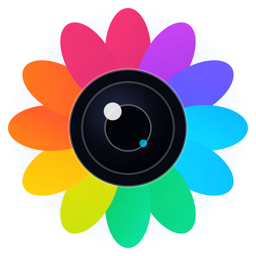
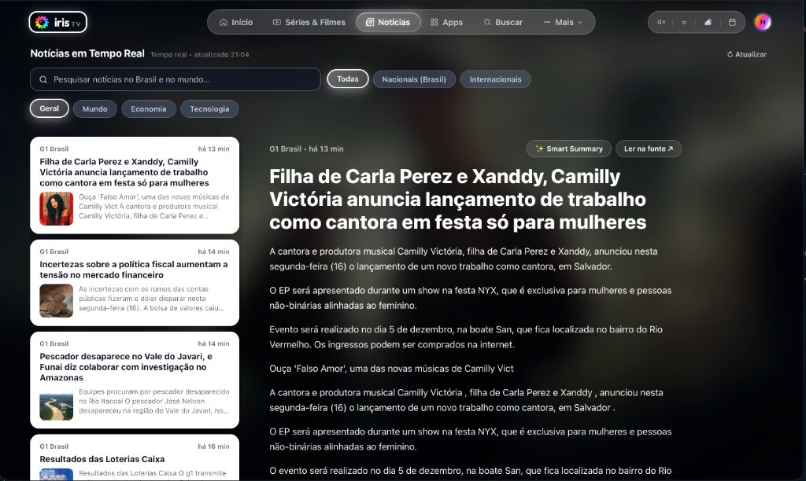

<div align="center">
  
  <h1>irisTV &amp; irisOS</h1>
  <p><strong>Central de TV, streaming e entretenimento estilo Apple TV — sem anúncios, 60 FPS e bootável direto do pendrive.</strong></p>

  <p>
    
    
    
    
  </p>

  <p>
    <a href="#capturas-de-tela">Capturas</a> •
    <a href="#principais-recursos">Recursos</a> •
    <a href="#como-rodar">Como Rodar</a> •
    <a href="#irisos-boot-pelo-pendrive">irisOS (Pendrive)</a> •
    <a href="#estrutura-do-projeto">Estrutura</a> •
    <a href="#atalhos-de-controle-e-teclado">Atalhos</a>
  </p>
</div>

---

## Visão Geral

O **irisTV** transforma computadores, mini PCs e TV Boxes em uma Smart TV completa com visual inspirado no tvOS/macOS, foco fluido para controle remoto, teclado ou mouse, e zero anúncios na tela inicial.

Ele pode rodar tanto como aplicativo no **macOS / Linux / Windows** quanto como sistema operacional próprio (**irisOS**) inicializado diretamente de um pendrive USB.

---

## Capturas de Tela


| Detalhes de Séries e Filmes | Notícias em Duas Colunas |
| :---: | :---: |
|  |  |

### Demonstração


---

## Principais Recursos

| Área | Destaques |
| :--- | :--- |
| **Interface &amp; Personalização** | Temas (Padrão, Claro, Preto Puro OLED, Verde Escuro), cores de destaque, wallpapers 4K com troca suave a cada 5 min, Modo Infantil, seções reordenáveis e **Sobre o Dispositivo** com hardware real e render estilo Apple. |
| **Central de Mídia** | Player de músicas com disco de vinil reativo à capa, letras sincronizadas em tempo real (LRCLIB + seletor de letra alternativa), fade-in/fade-out, playlist contínua e reprodução de filmes/séries locais com legendas `.srt`/`.vtt` + gerenciador USB. |
| **TV ao Vivo &amp; DVR** | Playlists M3U/M3U8, verificação automática de sinal, guia EPG de 5 dias, gravação ao vivo/agendada (DVR) e legendas automáticas em tempo real. |
| **Catálogo &amp; Streaming** | Séries e filmes com notas (IMDb, Rotten Tomatoes, TMDB, TVMaze), elenco, trailers em tela cheia, marcação de episódios e integração com Netflix, Prime Video, Disney+, Max, YouTube, Spotify e outros. |
| **Apps &amp; Troca Rápida** | Loja **irisStore** com suporte a `.apk` Android TV (Waydroid + Widevine L3) e Web Apps, splash com ícone do app e troca rápida com restauração de sessão. |
| **Iris Browser &amp; Utilitários** | Navegador embutido com abas persistentes, prefetch no hover e proxy com cache LRU + compressão gzip/brotli; Clima, Calculadora, Relógio, Notas, Casa Inteligente, Cofre de Senhas e 5 jogos nativos. |

<details>
<summary><strong>Ver lista completa de recursos</strong></summary>

- **Navegação**: Controle remoto, setas do teclado, mouse, controle de videogame, HDMI-CEC, teclado virtual na tela e ponteiro virtual.
- **Descanso de Tela (Lock Screen)**: Relógio sobre wallpapers 4K ou destaque automático de filmes/séries (bloqueado automaticamente enquanto há música ou vídeo tocando).
- **Áudio &amp; Sistema**: Controle real de volume e mudo do sistema operacional, Wi-Fi, bateria, energia (apagar tela / fechar app) e perfis de usuário.
- **Modo Desenvolvedor**: Refazer onboarding completo, testar animações e simular boot limpo.

</details>

---

## Como Rodar

### Pré-requisitos
- **Node.js** (v18+ recomendado)
- *(Opcional no macOS)* Xcode Command Line Tools caso queira recompilar `webview.swift`
- *(Opcional para edição/conversão de vídeo)* `ffmpeg`

### Executar localmente

```bash
git clone https://github.com/goiristv/iristv-os.git
cd iristv-os
node server.js
```

Depois acesse **`http://127.0.0.1:3000`** no navegador ou abra o app nativo no macOS:

```bash
./irisTV
```

---

## irisOS (Boot pelo Pendrive)

O diretório [`os/`](os/) contém a base do **irisOS**, uma imagem Linux enxuta (Alpine + Cage Wayland + WPE WebKit Cog / Chromium + Waydroid) que inicia direto na interface da TV a partir de um pendrive USB:

- **`os/irisos-session.sh`**: Orquestra o boot rápido, drivers GPU (`i915` / Mesa), áudio ALSA/PipeWire, navegador em kiosk e container Android Waydroid com Widevine L3, USAP Pool, pré-aquecimento em RAM (`Page Cache`) e `skiagl`.
- **`irisTV.apkovl.tar.gz`**: Overlay persistente gravado na raiz do pendrive (`/opt/iristv/`).

---

## Estrutura do Projeto

```text
irisoS/
├── server.js              # Servidor HTTP/API (mídia, proxy, EPG, DVR, OS, Waydroid, letras)
├── index.html             # Shell principal da interface TV
├── app.js                 # Lógica da Home, Configurações, TV ao Vivo, Catálogo e Hardware
├── app-player.js          # Central de Mídia (Músicas, Vinil, Letras LRCLIB, Vídeos e USB)
├── app-native.js          # Apps nativos (Iris Browser com cache, Clima, Relógio, Calculadora, Notas)
├── app-store.js           # Loja de aplicativos (irisStore) e instalação de APKs/Web Apps
├── app-games.js           # Jogos nativos integrados (Snake, 2048, Tetris, Pong, Memória)
├── styles.css             # Sistema visual glassmorphism, temas e animações a 60 FPS
├── webview.swift          # Wrapper nativo macOS (WKWebView com Metal/cache e fast switching)
├── device-catalog.json    # Catálogo de renders de estúdio para detecção de dispositivo
├── assets/devices/        # Renders WebP comprimidos estilo Apple (offline)
└── os/
    └── irisos-session.sh  # Script de inicialização e otimização do irisOS Linux
```

---

## Atalhos de Controle e Teclado

| Tecla / Controle | Ação |
| :--- | :--- |
| `↑` `↓` `←` `→` | Navegar entre cartões, abas e configurações |
| `Enter` / `OK` | Abrir item, reproduzir ou confirmar |
| `Esc` / `Backspace` | Voltar ou fechar janela/modal |
| `Espaço` | Play / Pause no player de música e vídeo |
| `-` / `+` / `M` | Diminuir volume, aumentar volume ou silenciar (Mudo) |
| `L` | Abrir/fechar biblioteca lateral no Media Player |

---

<div align="center">
  <sub>Desenvolvido para telas grandes — <strong>irisTV &amp; irisOS</strong></sub>
</div>
