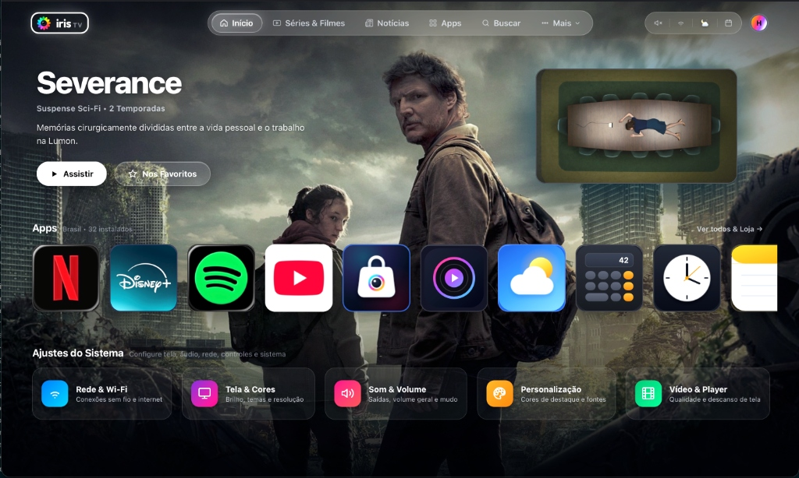
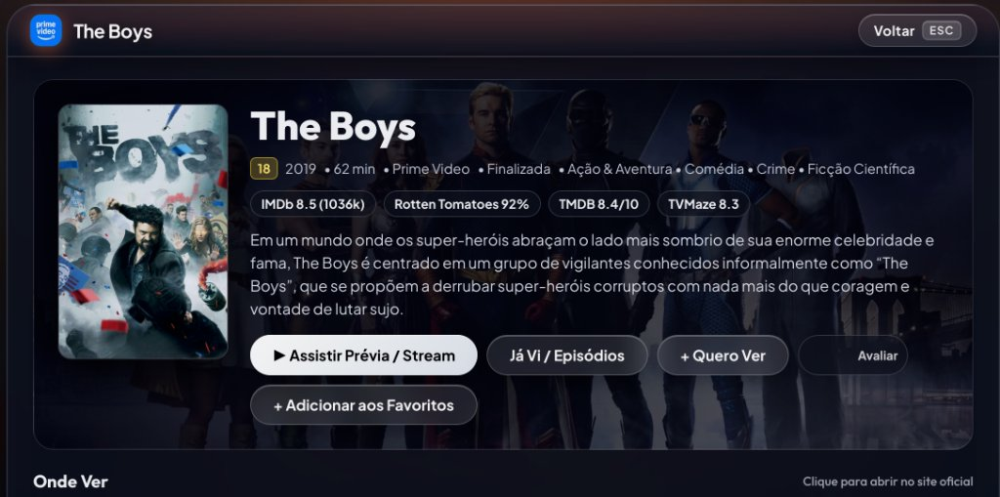
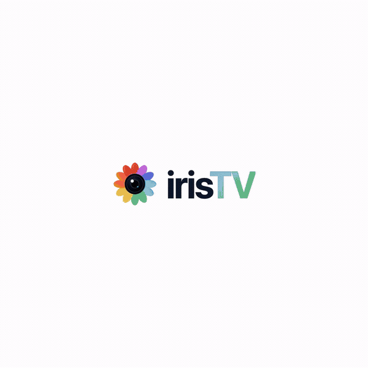

  
  <h1>irisTV</h1>

O irisTV é um sistema de televisão e entretenimento feito para transformar computadores, mini PCs ou dispositivos dedicados em uma central de TV completa, sem anúncios na tela inicial e com navegação pensada para controle remoto, teclado ou mouse.

---

## Capturas de Tela

| Detalhes de Séries e Filmes | Notícias com Leitor Completo |
| :---: | :---: |
|  |  |

---

## Demonstração

---

## Principais Recursos

### Tela Inicial e Navegação
- Tela inicial limpa com destaque dinâmico para o item selecionado, fila de aplicativos, canais e conteúdo em andamento.
- Navegação por controle remoto, setas do teclado, mouse, controle de videogame e controle da própria TV via HDMI-CEC.
- Teclado virtual na tela para buscas e preenchimento de campos sem precisar de teclado físico.
- Ponteiro virtual (cursor na tela) controlado pelas próprias setas do controle remoto quando algum site exigir clique tradicional.
- Barra superior automática opcional que se oculta ao rolar a tela.
- Modo Infantil / Família para restringir o catálogo exibido a conteúdos adequados.

### TV ao Vivo, Guia de Programação e Gravações (DVR)
- Reprodução de canais abertos e playlists próprias importadas por link ou arquivo local (M3U / M3U8).
- Aba dedicada de TV ao Vivo com pré-visualização imediata, programação atual e lista lateral de canais.
- Verificação automática de disponibilidade dos canais (sinal online ou fora do ar).
- Guia de programação de 5 dias em grade por horário com linha indicativa do programa em exibição no momento.
- Gravação de canais ao vivo (DVR) com opção de gravar na hora ou agendar gravações, mantendo a gravação ativa mesmo ao trocar de canal.
- Legendas automáticas ao vivo geradas em tempo real durante a transmissão.

### Séries e Filmes
- Catálogo unificado de filmes e séries com busca, filtros por gênero e recomendações personalizadas.
- Página de detalhes com sinopse, ano, duração, classificação indicativa, avaliações (IMDb, Rotten Tomatoes, TMDB e TVMaze), elenco com fotos e lista de episódios por temporada.
- Botão principal para abrir diretamente o serviço oficial onde o título está disponível, com opção integrada para assistir ao trailer oficial em tela cheia.
- Acompanhamento pessoal: avaliação por estrelas, lista "Quero Ver" e marcação individual de episódios ou temporadas inteiras assistidas.
- Armazenamento local das informações de filmes e séries já finalizadas para carregamento mais rápido.

### Central de Mídia (Músicas, Filmes, Séries e Pen-Drive)
- **Músicas**: reprodução de arquivos locais de áudio com capas automáticas, playlists personalizadas, visualização estilo disco de vinil e letras sincronizadas em tempo real.
- **Filmes e Séries Locais**: reprodução de vídeos do aparelho ou pen-drive com detecção automática de filmes e episódios, busca de capa, ano e nota para filmes, retomada do ponto em que parou e suporte a legendas externas (.srt e .vtt) com ajuste de tamanho.
- **Explorador de Arquivos e Pen-Drive**: navegação por pastas e dispositivos USB conectados, criação de pastas, renomeação, duplicação, cópia/movimentação, exclusão, visualização de propriedades, conversão de formatos e ferramentas rápidas de edição de vídeo (corte, rotação e recorte).

### Notícias em Tempo Real
- Leitor em duas colunas com manchetes do Brasil e do mundo separadas por categorias (Geral, Mundo, Economia e Tecnologia) e busca por palavra-chave.
- Leitura da matéria completa na própria tela, sem precisar sair do sistema.
- Opção de resumo automático em tópicos no topo da notícia e atalho para abrir a fonte original.

### Loja de Aplicativos (irisStore) e Serviços de Streaming
- Loja organizada por categorias: Nativos e Jogos, Streaming e TV, Esportes e Notícias, Música e Rádio, Jogos, IA e Trabalho, Social e Educação.
- Instalação e remoção de aplicativos, além de suporte para adicionar Web Apps personalizados por endereço.
- Suporte integrado para serviços como Netflix, Prime Video, Disney+, Max, Paramount+, Apple TV+, Globoplay, YouTube, Spotify, Crunchyroll, Pluto TV, Tubi, ESPN, Premiere, F1 TV, NBA, NFL e outros.

### Aplicativos Utilitários e Jogos Embutidos
- **Clima**: previsão local em tempo real exibida também na barra superior.
- **Calculadora**: calculadora completa para uso na tela da TV.
- **Relógio**: horário, cronômetro, timer e alarmes.
- **Notas**: bloco de anotações salvo localmente.
- **Navegador Web**: acesso direto a páginas da internet.
- **Casa Inteligente**: painel rápido para iluminação, modo econômico e sincronização de luz ambiente.
- **Jogos Nativos**: cinco jogos integrados prontos para jogar (Snake, 2048, Tetris, Pong e Jogo da Memória).

### Cofre de Senhas Integrado
- Salvamento criptografado de usuários e senhas dentro do próprio sistema.
- Preenchimento automático em páginas de login abertas dentro do irisTV.
- Área dedicada nas configurações para visualizar contas salvas, copiar senhas, adicionar novas ou remover registros.

### Tela, Cores e Personalização Visual
- **Tela e Cores**: temas gerais (Padrão, Claro, Preto Puro, Verde Escuro), modos de imagem (Padrão, Filme, Cores Fortes, Noturno), ajustes individuais de brilho, contraste, saturação e temperatura de cor (Frio, Neutro, Quente), modo noturno automático por horário, tema automático seguindo o sistema operacional, modo econômico, margem de segurança da TV (ajuste de bordas) e nitidez de texto.
- **Personalização**: escolha de papel de parede em alta resolução, troca automática a cada minuto, nível de escurecimento do fundo, cor de destaque, estilo de fonte, escala de texto e cartões, formato dos cantos, intensidade de luz ambiente, nível de transparência/desfoque dos painéis (com opção de desligar totalmente para maior desempenho), linhas decorativas, foco reforçado, redução de animações, estilo de foco, densidade da grade, ocultação de rótulos de aplicativos até o foco e opção para usar banners de filmes e séries como papel de parede.
- **Tela Inicial Configurável**: ocultar banner de destaque, mostrar/ocultar cada seção individualmente e reordenar a posição das seções.
- **Descanso de Tela (Lock Screen)**: exibição de relógio (canto inferior ou centralizado) sobre papéis de parede em 4K ou modo automático com rotação de filmes e séries, mostrando o título e botão direto para assistir.
- **Áudio, Rede e Sistema**: controle real de volume, mudo, conexão Wi-Fi, status de bateria, energia (apagar tela / desligar), criação e troca de perfis de usuário e tema padrão configurável por arquivo.

---

## Plataformas Compatíveis
- **Sistema Operacional Próprio (irisOS)**: imagem inicializável para PCs e mini PCs, iniciando diretamente na interface da TV.
- **macOS**: aplicativo dedicado com aceleração gráfica e suporte a controle remoto.
- **Windows e Linux**: execução em modo tela cheia pelo navegador ou aplicativo dedicado.
